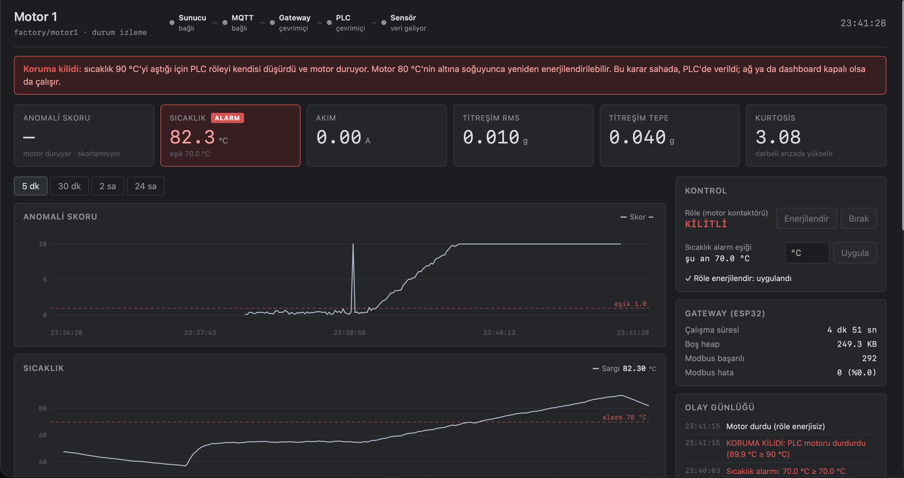
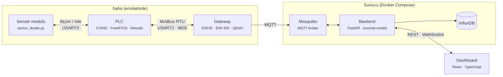
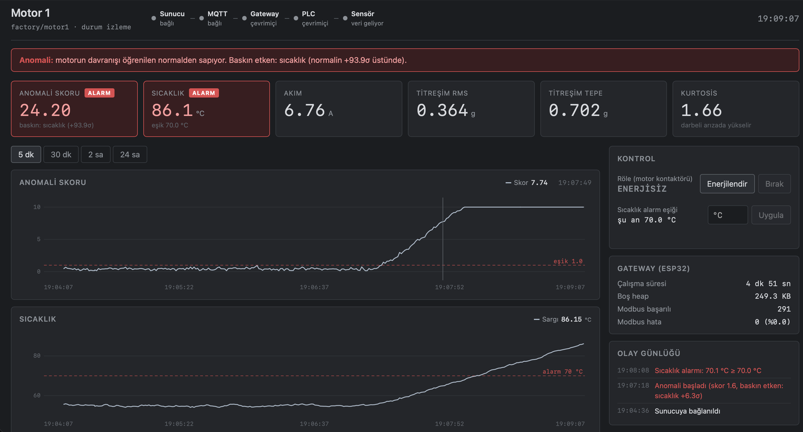

# industrial-iot-monitoring

Bitirme projem için yaptığım bir motor izleme sistemi. Bir elektrik motorundan gelen titreşim,
sıcaklık ve akım verisini sahadaki bir PLC'den alıp bir gateway üzerinden sunucuya taşıyor,
veritabanına yazıyor, bir anomali modeliyle değerlendiriyor ve web arayüzünde gösteriyor.
Motor aşırı ısınırsa PLC röleyi kendisi düşürüp motoru durduruyor.

Şu an elimde kart olmadığı için her şey emülatörde çalışıyor: STM32 tarafı Renode'da, ESP32
tarafı Espressif'in QEMU'sunda. Firmware'ler register seviyesinde yazıldı, yani ileride gerçek
Blue Pill + ESP32 + MAX485 ile kurduğumda değişecek kısım çoğunlukla pin ve saat ayarları olacak.



*(EN: Motor condition monitoring project. STM32 + FreeRTOS PLC (Modbus RTU slave) in Renode,
ESP32 gateway in QEMU, MQTT, FastAPI + InfluxDB backend, Isolation Forest based anomaly
detection, React dashboard.)*

## Mimari



Kısaca parçalar:

- **Sensör modülü** (`tools/sensor_feeder.py`, `sensor_sim.py`): Gerçek sensör olmadığı için motoru
  Python'da simüle ediyorum. 10 kHz titreşim sinyali üretip RMS, tepe ve kurtosis çıkarıyor; sıcaklık
  ve akımı da ekleyip USART3 üzerinden PLC'ye gönderiyor. Normal çalışmanın yanında rulman hasarı,
  dengesizlik ve aşırı ısınma modları var. PLC'den gelen röle bilgisine göre motor durup kalkıyor.
- **PLC** (`firmware/bluepill_rtos`): STM32F103 üzerinde FreeRTOS. Üç görev var: Modbus isteklerini
  cevaplayan, sensör hattını okuyan ve röleyi süren. Sensörden 2 sn veri gelmezse kopuk sayıyor.
- **Gateway** (`firmware/esp32_gateway`): Saniyede bir PLC'yi Modbus ile okuyup JSON olarak MQTT'ye
  yayınlıyor. Dashboard'dan gelen komutları da Modbus yazmaya çeviriyor.
- **Backend** (`backend/`): Gelen mesajları kontrol edip InfluxDB'ye yazıyor, anomali skorunu
  hesaplıyor, dashboard'a WebSocket ile canlı veri veriyor.
- **Dashboard** (`dashboard/`): React ile yazdım, grafikleri kütüphane kullanmadan SVG ile çizdim.

### Modbus register'ları (slave 1)

| Tip | Adres | İçerik | Ölçek |
|---|---|---|---|
| Input (FC04) | 0 | Titreşim RMS | g × 1000 |
| | 1 | Titreşim tepe | g × 1000 |
| | 2 | Kurtosis | × 100 |
| | 3 | Sıcaklık | °C × 100 |
| | 4 | Akım | A × 1000 |
| | 5 | Ölçüm sayacı | |
| | 6 | Durum bitleri (0: sensör kopuk, 1: sıcaklık alarmı, 2: koruma kilidi) | |
| Holding (FC03/FC06) | 0 | Röle (0/1) | |
| | 1 | Sıcaklık alarm eşiği | °C × 100 |

## Anomali tespiti

Modeli sadece normal çalışma verisiyle eğittim, çünkü gerçek hayatta elinizde etiketli arıza verisi
pek olmuyor. Arıza verisini sadece değerlendirmede kullandım. Başta yalnızca Isolation Forest
kullanıyordum ama aşırı ısınmanın ancak yarısını yakalıyordu: değer eğitim aralığının dışına çıkınca
skor bir yerde sabitleniyor, 60 °C ile 100 °C neredeyse aynı skoru alıyordu. Yanına her özelliğin
normalden kaç standart sapma uzak olduğuna bakan bir z-skoru ekleyince bu düzeldi. Detaylar ve
grafikler [`ml/reports/egitim_raporu.md`](ml/reports/egitim_raporu.md) içinde.

Arıza şiddeti yavaş yavaş artırıldığında ilk alarmın ne zaman geldiği:

| Arıza | Anomali modeli | Sıcaklık ≥ 70 °C kuralı |
|---|---|---|
| Rulman hasarı | 7,5 sn | çalmadı |
| Dengesizlik | 1,5 sn | çalmadı |
| Aşırı ısınma | 9 sn | 59 sn |

Eğitimde kullanmadığım 2000 normal pencerede sahte alarm çıkmadı (alarm için art arda 3 pencere
eşiği geçmeli). Canlı sistemde aşırı ısınmayı denediğimde model motor ~57 °C'deyken uyardı, 70 °C
alarmı bundan 49 sn sonra geldi.

Simülatörün "normal"i gerçek bir motordan çok daha düzgün olduğu için bu sayılar iyimser. Gerçek
veride model daha geç tepki verir ve yeniden eğitmek gerekir.



## Yaparken verdiğim bazı kararlar

- Koruma kilidi PLC'de. Sıcaklık 90 °C'ye gelince PLC röleyi kendisi bırakıyor; bu eşik kodda sabit
  ve ağdan değiştirilemiyor, çünkü ağ koptuğunda da çalışması gerekiyor. Kilit 80 °C'nin altında
  açılıyor ama röle kendiliğinden geri gelmiyor, operatörün tekrar enerjilendirmesi lazım. Dashboard'daki
  70 °C ise sadece uyarı, uzaktan değiştirilebiliyor.
- PLC açılışta röleyi kapalı başlatıyor. Elektrik gidip gelince motorun kendi kendine kalkmasını
  istemedim.
- Sensör kopunca PLC son değeri tutmaya devam ediyor. Bu değerleri veritabanına yazmıyorum ve
  arayüzde üstü çizili gösteriyorum, yoksa grafikte sahte bir düz çizgi oluşuyordu.
- Gateway kopuksa broker'daki son "PLC online" mesajına güvenmiyorum, PLC'yi "bilinmiyor" sayıp
  komut göndermeyi kapatıyorum.
- Motor dururken ve kalktıktan sonraki 30 sn anomali skorlanmıyor. Soğuk kalkan motor modele
  anormal görünüyordu ve her kalkışta yanlış alarm veriyordu.
- ESP32'de gerçek saat olmadığı için ölçüm zamanını backend'de, mesaj geldiği anda (UTC) atıyorum.
- Arayüzde ISA-101'e uymaya çalıştım: normal durum gri, renk sadece bir sorun olunca.

## Çalıştırma

Mac (Apple Silicon) üzerinde geliştirdim. Gerekenler: Renode 1.17, PlatformIO, ESP-IDF 6.1 ve
Espressif QEMU, Docker Desktop, Python 3.12+, Node.js 20+.

```bash
git clone --recurse-submodules <repo-adresi>
cd industrial-iot-monitoring
python3 -m venv .venv && source .venv/bin/activate && pip install -r requirements.txt
(cd firmware/bluepill_rtos && pio run)
(cd dashboard && npm install)
docker compose up -d --build
```

Sonra ayrı terminallerde, bu sırayla:

```bash
cd firmware/bluepill_rtos && renode --console rtos.resc        # PLC
python tools/sensor_feeder.py                                  # sensör (venv açık)
cd firmware/esp32_gateway && idf.py qemu --qemu-extra-args="-serial tcp:127.0.0.1:3456" monitor
cd dashboard && npm run dev                                    # http://localhost:5173
```

API belgeleri http://localhost:8000/docs, InfluxDB arayüzü http://localhost:8086 adresinde.

Demo için: dashboard'dan **Enerjilendir**'e basın, motor kalksın. Sonra sensörü arızalı modda
yeniden başlatın:

```bash
python tools/sensor_feeder.py --mode overheating --severity 0 --degrade 0.003
```

Önce anomali alarmı, sonra 70 °C alarmı, en son 90 °C'de koruma kilidi geliyor ve motor duruyor.
`--mode bearing` ve `--mode imbalance` ile diğer arızalar denenebilir.

Model repoda hazır (`ml/model/`). Yeniden eğitmek isterseniz `python ml/train.py`, ardından
`docker compose restart backend`.

## Testler

```bash
cd firmware/bluepill_rtos
cc -Wall -Iinclude -o tests/test_modbus tests/test_modbus.c src/modbus.c && ./tests/test_modbus
cc -Wall -Iinclude -o tests/test_sensor_link tests/test_sensor_link.c src/modbus.c src/sensor_link.c && ./tests/test_sensor_link

cd ../esp32_gateway   # gateway'in Modbus master kodu, PLC'nin slave koduna karşı
cc -Wall -Imain -I../bluepill_rtos/include -o tests/test_master_vs_slave \
   tests/test_master_vs_slave.c main/modbus_proto.c ../bluepill_rtos/src/modbus.c && ./tests/test_master_vs_slave

cd ../../backend && python -m unittest discover -s tests
```

ESP-IDF ortamı açık bir terminalde `cc` Espressif'in derleyicisini çağırabiliyor, o zaman
`/usr/bin/clang` yazmak gerekiyor. Renode açıkken `python tools/modbus_test.py` ile PLC'ye doğrudan
Modbus testi de yapılabilir (gateway kapalı olmalı, port tek bağlantı kabul ediyor).

## Eksikler

- Simülatörde akım ile ısınma arasındaki fiziksel ilişki (I²R) yok, ikisi arıza şiddetinden ayrı
  ayrı hesaplanıyor.
- MQTT anonim ve şifresiz, InfluxDB token'ı varsayılan değerde. Sadece yerel geliştirme için.
- Tek motor var. Birden fazla motor için Modbus adresleri ve MQTT başlıkları genişletilmeli.
- Dashboard henüz Docker'da değil, `npm run dev` ile çalışıyor.
