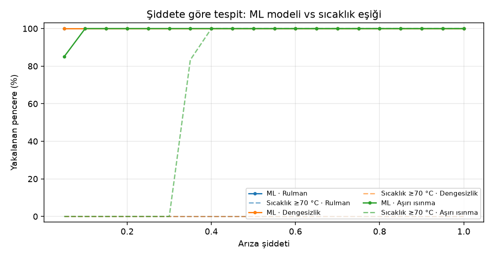
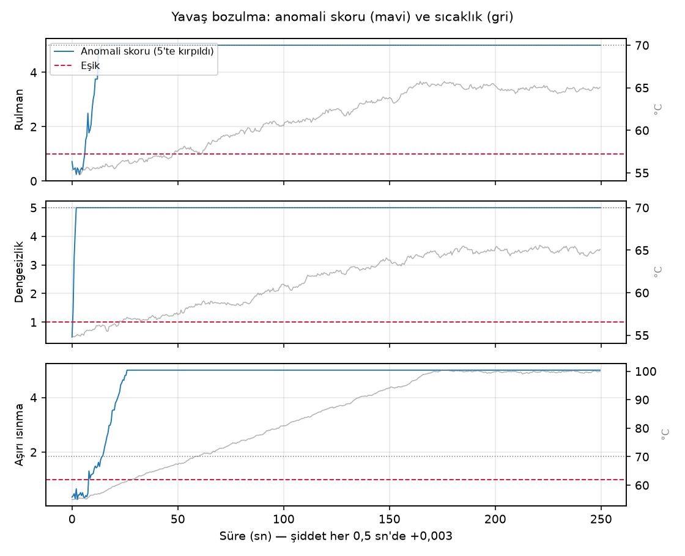

# Anomali modeli eğitim raporu

Eğitim zamanı: 2026-11-16T16:02:23+00:00 · scikit-learn 1.9.1

## Yöntem

- Model: StandardScaler + Isolation Forest (300 ağaç) + z-skoru bileşeni, **sadece normal veriyle** eğitildi (3000 pencere).
- Birleşik skor = max(IF skoru / 0.1227, en büyük |z| / 3.88). 1'in üstü anomali.
- Özellikler: vib_rms, vib_peak, kurtosis, temp_c, current_a. Değerler STM32 register çözünürlüğüne yuvarlandı.
- Bileşen eşikleri: eğitimde görülmemiş 2000 normal pencerenin %99.75'lik dilimi.
- Alarm kuralı: art arda 3 pencere eşiğin üstünde.

## Sahte alarm

| | Oran |
|---|---|
| Tek pencere | %0.40 |
| 3 ardışık kuralı | %0.00 |

## Şiddete göre yakalama oranı (%)

| Şiddet | ML · Rulman | ML · Dengesizlik | ML · Aşırı ısınma | ≥70 °C · Rulman | ≥70 °C · Dengesizlik | ≥70 °C · Aşırı ısınma |
|---|---|---|---|---|---|---|
| 0.05 | 100 | 100 | 85 | 0 | 0 | 0 |
| 0.10 | 100 | 100 | 100 | 0 | 0 | 0 |
| 0.15 | 100 | 100 | 100 | 0 | 0 | 0 |
| 0.20 | 100 | 100 | 100 | 0 | 0 | 0 |
| 0.30 | 100 | 100 | 100 | 0 | 0 | 0 |
| 0.50 | 100 | 100 | 100 | 0 | 0 | 100 |
| 1.00 | 100 | 100 | 100 | 0 | 0 | 100 |

### Neden z-skoru bileşeni?

Sadece Isolation Forest kullanılsaydı yakalama oranı (%):

| Şiddet | Rulman | Dengesizlik | Aşırı ısınma |
|---|---|---|---|
| 0.05 | 100 | 100 | 17 |
| 0.10 | 100 | 100 | 32 |
| 0.15 | 100 | 100 | 50 |
| 0.20 | 100 | 100 | 38 |
| 0.30 | 100 | 100 | 47 |
| 0.50 | 100 | 100 | 60 |
| 1.00 | 100 | 100 | 47 |

Aşırı ısınmada Isolation Forest'ın skoru doyuyor: 100 °C'lik motor, normal verideki gürültü noktalarıyla aynı skoru alıyor. z-skoru bu açığı kapatıyor.

## Yavaş bozulmada ilk alarm

Şiddet 0'dan başlayıp her 0,5 sn'de 0,003 artıyor (dashboard testindeki gibi).

| Arıza | ML alarmı | ML'de şiddet | ≥70 °C alarmı | Kuralda şiddet |
|---|---|---|---|---|
| Rulman | 7.5 sn | 0.045 | yok | yok |
| Dengesizlik | 1.5 sn | 0.009 | yok | yok |
| Aşırı ısınma | 9.0 sn | 0.054 | 59.0 sn | 0.354 |

## Sınırlar

- Veri simülatörden geliyor; model simülatörün 'normal'ini öğrendi. Gerçek motorda yük değişimi, ortam sıcaklığı gibi normal çeşitlilik daha fazladır ve yeniden eğitim gerekir.
- Soğuk başlangıç (motor ısınırken) normal veride yok; ısınma sırasında anomali görülmesi beklenir.
- Model anomali olduğunu söyler, arızanın türünü söylemez. Tür için hangi özelliğin saptığına bakılır (backend bunu z-skoru ile gösteriyor).
